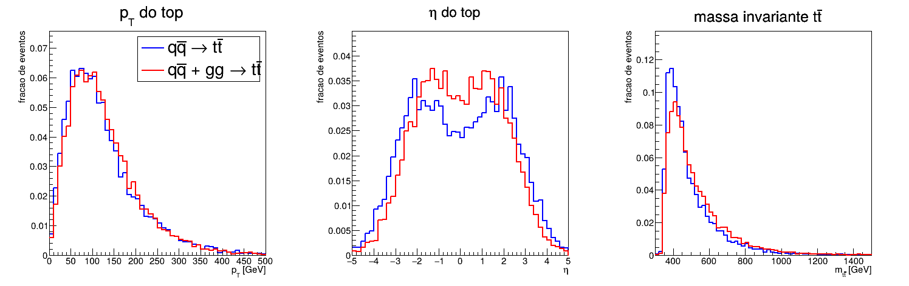

# F056 - Seção de choque pp -> t tbar: Pythia8 vs MadGraph5_aMC@NLO

pp -> t tbar a sqrt(s) = 13 TeV, calculado com o Pythia8 (processos internos) e com o MadGraph5_aMC@NLO (parton level).

Usei o Pythia 8.312 e o ROOT 6.40 do ambiente conda `rootenv` e o MadGraph5_aMC@NLO 3.6.7 (sem LHAPDF, ele usa a PDF interna).

## Arquivos

- `ttbar_pythia.cc` - programa do Pythia8 (o esqueleto do enunciado completado)
- `Makefile`
- `pythia_qq.log`, `pythia_total.log`, `pythia_total_100k.log` - saída completa dos runs (com o `pythia.stat()`)
- `plot_ttbar.C` - macro da parte opcional (pT, eta e m_ttbar)
- `ttbar_qq.root`, `ttbar_total.root` - histogramas
- `ttbar_distribuicoes.png`
- `madgraph_cmds.txt` - comandos passados para o `mg5_aMC`
- `madgraph_run_01/` - banner do run_01, `crossx.html` e o resumo que sai no terminal

## Como rodar

Pythia:
```
conda activate rootenv
make
make run        # roda ./ttbar_pythia qq e ./ttbar_pythia total (uns 2 min)
make plot
```
`./ttbar_pythia total 100000` roda com outro número de eventos.

MadGraph (ele não vem no conda, baixei o tarball do launchpad e precisei de um gfortran):
```
./bin/mg5_aMC madgraph_cmds.txt
```
O arquivo já responde as perguntas do `launch` (shower, detector e analysis em OFF) e coloca 10000 eventos e semente fixa.

## Decisão sobre o canal gg -> t tbar

Rodei os dois:

- `qq`: só `Top:qqbar2ttbar = on`, que é o que o enunciado pede;
- `total`: `Top:qqbar2ttbar = on` + `Top:gg2ttbar = on`.

O valor que eu uso pra comparar com o MadGraph é o **total**, porque o `generate p p > t t~` soma todos os
subprocessos partônicos (o MadGraph gerou o `P1_gg_ttx` e o `P1_qq_ttx`). Só o qqbar seria comparar coisas
diferentes. Mesmo assim, como o MadGraph guarda o resultado de cada subprocesso separado
(`SubProcesses/P1_*/G*/results.dat`), deu pra comparar o qqbar sozinho também.

## Parte 1 - Pythia8

| run | eventos | sigma (pb) |
|---|---|---|
| só q qbar -> t tbar | 10000 | 65.12 ± 0.34 |
| q qbar + g g -> t tbar | 10000 | 512.2 ± 2.6 |
| q qbar + g g -> t tbar | 100000 | 509.1 ± 0.8 |

A tabela do `pythia.stat()` separa os canais. No run total de 10k: g g -> t tbar = 446.2 ± 2.4 pb e q qbar -> t tbar = 66.1 ± 1.0 pb.
No de 100k: g g -> t tbar = 443.7 ± 0.8 pb e q qbar -> t tbar = 65.4 ± 0.3 pb.

- PDF: padrão do Pythia, NNPDF2.3 QCD+QED LO (`PDF:pSet = 13`), alpha_s(MZ) = 0.130 com running de 1 loop
  (`SigmaProcess:alphaSvalue`, `SigmaProcess:alphaSorder`)
- m_top = 173.0 GeV (`6:m0`), largura 1.4 GeV
- escalas (padrão para 2 -> 2): mu_R² = mT3·mT4 e mu_F² = min(mT3², mT4²). Como os dois tops têm a mesma massa e o
  mesmo pT, as duas viram **mu_R = mu_F = mT = sqrt(m_t² + pT²)**

## Parte 2 - MadGraph5_aMC@NLO

```
  === Results Summary for run: run_01 tag: tag_1 ===
     Cross-section :   504.5 +- 0.5453 pb
     Nb of events :  10000
```

Separado por subprocesso: g g -> t t~ = 440.5 ± 0.5 pb e q q~ -> t t~ = 64.0 ± 0.2 pb.

Do banner (`madgraph_run_01/run_01_tag_1_banner.txt`):

- PDF: `pdlabel = nn23lo1`, NNPDF2.3 LO (alpha_s(MZ) = 0.130), interna do MadGraph. O `aS = 0.118` do param_card
  não é usado quando tem PDF ("this parameter is not used if you use a pdf set")
- ordem: LO (árvore), modelo `sm`, m_top = 173.0 GeV
- escalas: `fixed_ren_scale = False`, `fixed_fac_scale = False`, `dynamical_scale_choice = -1` (padrão): o evento é
  clusterizado até um 2 -> 2 e usa a massa transversa dele, que aqui (já é 2 -> 2) é o mT do top. `scalefact = 1`
- `maxjetflavor = 4` e o `p` do modelo `sm` padrão não tem o quark b (esquema de 4 sabores), então não entra b bbar -> t tbar

## Parte 3 - Comparação

| Gerador | sigma (pb) | Incerteza (pb) | PDF |
|---|---|---|---|
| Pythia8 (interno, qqbar + gg, 10k) | 512.2 | 2.6 | NNPDF2.3 QCD+QED LO |
| Pythia8 (interno, qqbar + gg, 100k) | 509.1 | 0.8 | NNPDF2.3 QCD+QED LO |
| MadGraph5_aMC@NLO | 504.5 | 0.5 | NNPDF2.3 LO (nn23lo1) |
| Pythia8 (só qqbar) | 65.1 | 0.3 | NNPDF2.3 QCD+QED LO |
| MadGraph5_aMC@NLO (só subprocesso qq) | 64.0 | 0.2 | NNPDF2.3 LO (nn23lo1) |

### Respostas (o que vai no email)

**1. Concordam dentro das incertezas?**
Quase, mas não exatamente. Com 10000 eventos o Pythia dá 512.2 ± 2.6 pb e o MadGraph 504.5 ± 0.5 pb: diferença de
7.7 pb, **1.5 %**, que é ~2.9 sigma somando as incertezas em quadratura. Pra ver se era só flutuação rodei também 100000 eventos:
509.1 ± 0.8 pb. A diferença caiu pra 4.6 pb (**0.9 %**), mas como a incerteza também diminuiu continua não sendo
compatível (~4.7 sigma). Separando por canal (100k): gg 443.7 vs 440.5 pb (0.7 %) e qqbar 65.4 vs 64.0 pb (2.2 %).
Ou seja, os dois geradores concordam em ~1 %, mas essa diferença é sistemática e não só estatística: aparece nos
dois canais e não some aumentando o número de eventos. As fontes possíveis estão no item 4.

**2. Mesma ordem e mesma PDF?**
Sim. Os dois são LO (elemento de matriz de árvore 2 -> 2) e usam NNPDF2.3 LO com alpha_s(MZ) = 0.130 (no Pythia a
versão QCD+QED, no MadGraph a `nn23lo1`). Também usam a mesma massa do top (173 GeV) e na prática a mesma escala
(mT do top). Isso importa porque a seção de choque LO depende muito dessas escolhas: só a PDF e o alpha_s já mudam
sigma em vários %, e a variação de escala no LO do ttbar é de uns 20-30 %. Se eu tivesse usado PDFs ou escalas
diferentes nos dois, a diferença ia ser dominada por isso e a comparação não diria nada sobre os programas.
Também por isso nenhum dos dois é o valor "certo": o valor medido pelo ATLAS/CMS a 13 TeV é ~830 pb, e o cálculo
NNLO+NNLL dá ~830 pb também. O LO subestima bastante (fator K ~1.6).

**3. O Pythia inclui o gg -> t tbar com `Top:qqbar2ttbar`?**
Não. `Top:qqbar2ttbar` liga só q qbar -> t tbar, que dá 65 pb, só ~13 % do total. Ligando `Top:gg2ttbar = on` a
seção de choque vai para 512 pb, ou seja o gg é **~87 %** do ttbar no LHC (no MadGraph também: 440.5/504.5 = 87 %).
Isso acontece porque pra produzir um par de tops precisa de x ~ 2m_t/sqrt(s) ~ 0.03, e nessa região a
densidade de glúons é muito maior que a de antiquarks no próton. Por isso, pra comparar com o `p p > t t~` do
MadGraph, que soma todos os subprocessos sozinho, o certo é usar o total (qqbar + gg) do Pythia. Comparar o 65 pb
com 504 pb daria uma "diferença" de 87 % que é só por faltar o canal dominante.

**4. Outras fontes de diferença além da estatística:**
- **Largura do top:** no MadGraph os tops do `p p > t t~` saem on-shell (massa fixa em 173 GeV). O Pythia sorteia a
  massa do top numa Breit-Wigner (largura 1.4 GeV, `6:mMin = 86 GeV`). Como sigma cai rápido com a massa
  perto do limiar, tops um pouco mais leves aumentam sigma, então isso pode explicar parte do Pythia dar mais alto.
- **Running do alpha_s:** os dois partem de alpha_s(MZ) = 0.130, mas o Pythia roda com 1 loop
  (`SigmaProcess:alphaSorder = 1`) e o MadGraph usa o running que vem junto da PDF. Como o ttbar é ~alpha_s², 1 % no
  alpha_s na escala ~200-300 GeV já dá 2 % em sigma.
- **Escalas:** apesar de serem as duas mT no 2 -> 2, a definição exata é diferente (o Pythia usa mT3·mT4 para mu_R²
  e o mínimo para mu_F²; o MadGraph usa o mT do 2 -> 2 clusterizado). Com massas diferentes por causa da
  Breit-Wigner, mT3 ≠ mT4 e as escalas não são mais idênticas.
- **Implementação da PDF:** o conjunto é o mesmo (NNPDF2.3 QCD+QED LO, alpha_s = 0.130), mas cada programa tem a
  sua cópia interna da grade e o seu código de interpolação, sem LHAPDF. Diferenças pequenas aparecem aí.
- **Sabores no próton:** o MadGraph está no esquema de 4 sabores (sem b no próton). O b bbar -> t tbar é
  minúsculo, mas é mais uma diferença de definição.

**5. Se o MadGraph rodasse o parton shower do Pythia8, a seção de choque mudaria?**
Não. O shower só adiciona radiação (ISR/FSR) aos eventos que já foram gerados, ele não muda o peso de cada evento
nem gera eventos novos. O shower é unitário: a probabilidade de emitir ou não emitir soma 1, então a seção de
choque total continua sendo a do elemento de matriz, e o MadGraph reporta o mesmo valor. A distribuição de
pT do par ttbar, número de jatos etc. muda, mas o sigma não. Dá pra ver isso no próprio Pythia: o `sigmaGen` é o
do processo duro, e testei rodando 100k eventos com `PartonLevel:all = off` (sem shower): deu 508.3 ± 0.8 pb,
compatível com os 509.1 ± 0.8 pb com o shower ligado. A exceção seria usar matching/merging
(MLM com `xqcut`, por exemplo, ou amostras com jatos extras), aí eventos são rejeitados depois do shower e o sigma
depois do matching muda.

## Parte opcional - distribuições



(histogramas normalizados pela área)

- **pT do top:** pico em ~80 GeV e cauda até centenas de GeV, quase igual nos dois casos.
- **eta do top:** no qqbar a distribuição é mais larga, com dois picos em |eta| ~ 2. No total (87 % gg) ela é mais central.
- **m_ttbar:** começa no limiar 2m_t ~ 346 GeV, pico logo depois (~400 GeV) e cauda longa. No total o pico é um pouco
  mais largo e com mais eventos em massa alta que no qqbar sozinho.
