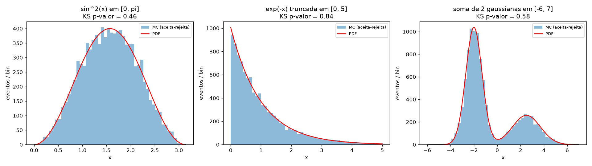
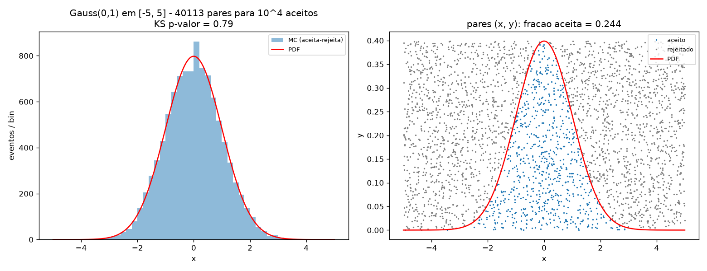
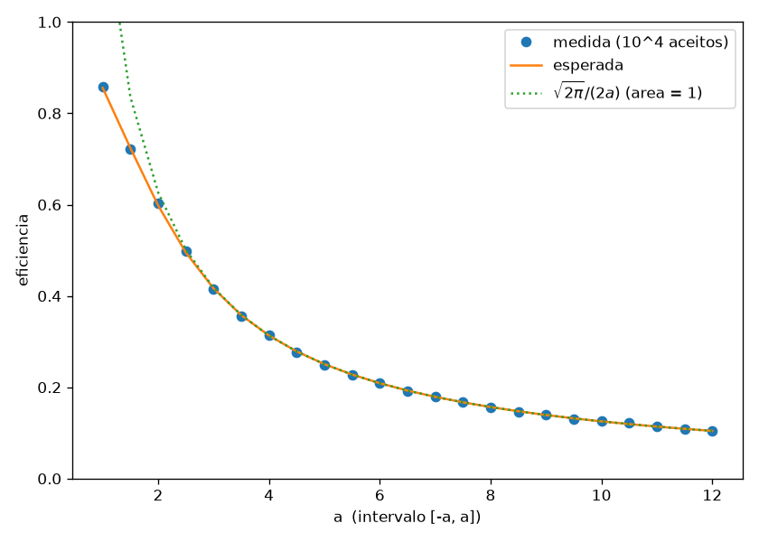
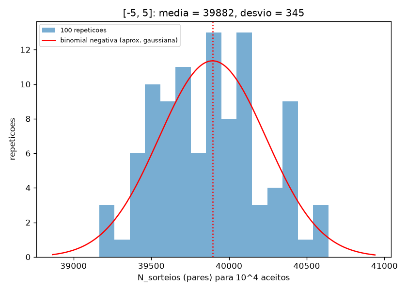
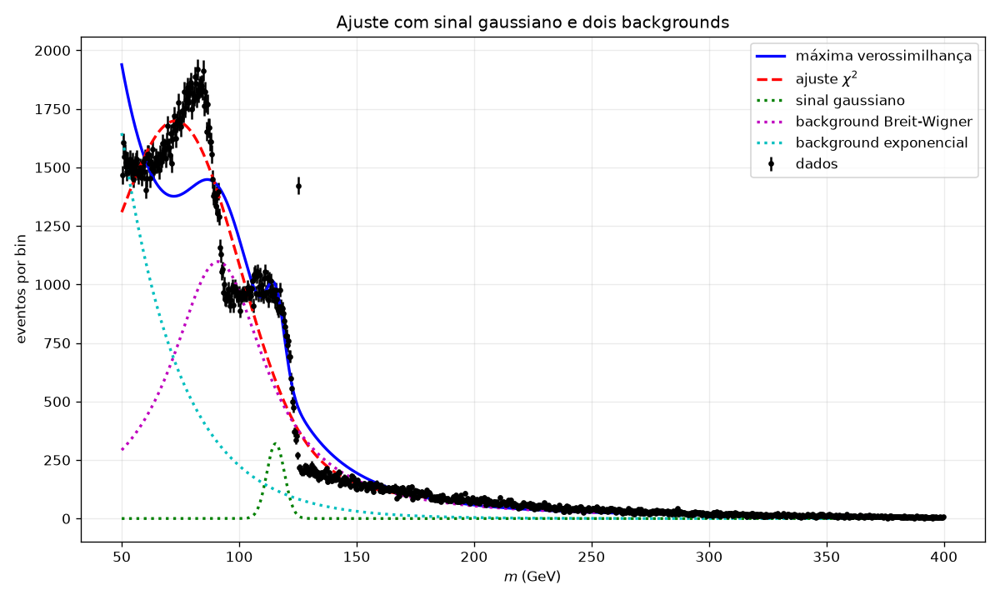
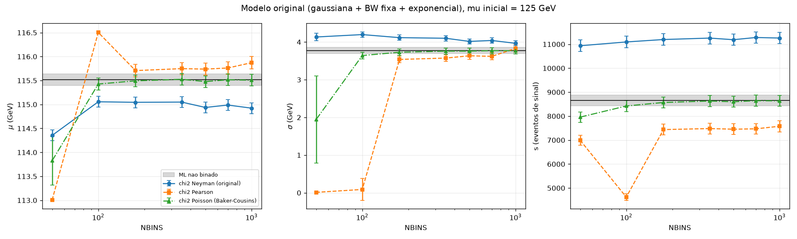
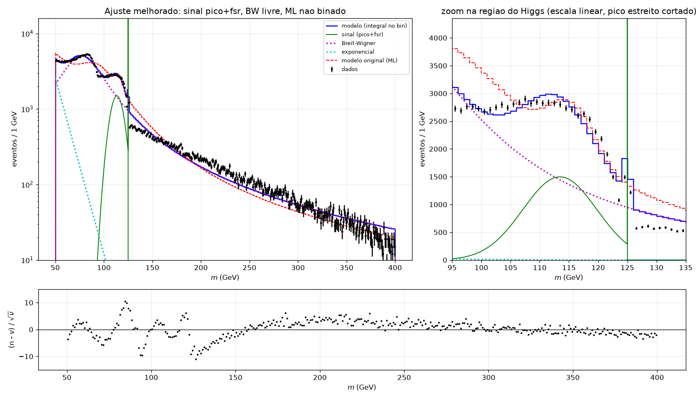

# F056 - Lista: Monte Carlo e Ajuste de Curvas com Minuit

## Arquivos

- `problema1_2_aceita_rejeita.py` - Problemas 1 e 2 (aceitação-rejeição)
- `ajuste_higgs_melhorado.py` - Problema 3, minha versão do `ajuste_higgs_v2.py`
- `roda_original.py` - roda o `ajuste_higgs_v2.py` original sem modificar e salva a figura dele
- `saida_problema1_2.txt`, `saida_original.txt`, `saida_ajuste_melhorado.txt` - saídas completas dos programas
- `figuras/` - todas as figuras

## Como rodar

Dependências: numpy, scipy, matplotlib, iminuit e PyROOT. Usei o ambiente conda `rootenv`
(ROOT 6.40, Python 3.14, iminuit 2.33, instalei o iminuit com `mamba install -n rootenv -c conda-forge iminuit`).

```
conda activate rootenv

# Parte I
python3 problema1_2_aceita_rejeita.py

# Parte II (o pythia_higgs.root NAO esta no repositorio: copiar de Exemplos/Estatistica/Example_2_Higgs)
cp <repo do professor>/Exemplos/Estatistica/Example_2_Higgs/pythia_higgs.root .
python3 roda_original.py <repo do professor>/Exemplos/Estatistica/Example_2_Higgs/ajuste_higgs_v2.py
python3 ajuste_higgs_melhorado.py          # uns 2 min (os ajustes nao binados com 322 mil eventos)
```

---

# Parte I - Monte Carlo

## Problema 1 - aceitação-rejeição

A função `aceita_rejeita(pdf, N, x_min, x_max, f_max=None)` recebe qualquer PDF definida pelo usuário (não precisa
estar normalizada) e devolve `(amostras, n_sorteios)`, onde `n_sorteios` é o número de **pares** (x, y)
sorteados (o número de uniformes usados é o dobro). Só uso `rng.uniform`:
x uniforme em [x_min, x_max], y uniforme em [0, f_max], e guardo x se PDF(x) > y.

Detalhes:
- Se `f_max` não for passado, ele é estimado numa grade fina (máximo × 1.05). Se em algum ponto sorteado
  PDF(x) > f_max, a função dá erro, porque nesse caso a distribuição gerada sairia errada (cortada no topo).
- Pra não ficar lento em Python, sorteio os pares em lotes de 10⁵, mas conto os sorteios só até o par que
  completou os N aceitos, então o `n_sorteios` é exatamente o que daria sorteando um par por vez.
- Diferença em relação ao esqueleto da lista: no esqueleto o y é sorteado em [0, 1], e não em [0, f_max], e
  `n_tries` conta números (+2 por par). Com y em [0, 1] a gaussiana funciona (máximo 0.399 < 1), mas a eficiência
  cai por um fator 1/0.399 ≈ 2.5, e uma PDF com máximo > 1 sairia errada.

Testei com mais três PDFs (10⁴ aceitos cada, KS com 2000 deles):

| PDF | f_max | pares | eficiência | esperada | KS p-valor |
|---|---|---|---|---|---|
| sin²(x) em [0, π] | 1 | 19850 | 0.504 | 0.500 | 0.46 |
| e^(-x) truncada em [0, 5] | 1 | 50144 | 0.199 | 0.199 | 0.84 |
| soma de 2 gaussianas em [-6, 7] | 0.419 (estimado) | 54586 | 0.183 | 0.184 | 0.58 |



## Problema 2 - distribuição normal

### (a) Gauss(0, 1) em [-5, 5], f_max = 1/sqrt(2π)

Para obter os 10⁴ números precisei de **40113 pares** (80226 números uniformes).

- eficiência medida: ε = 10⁴ / 40113 = **0.2493**
- esperada: ε = ∫PDF / ((x_max − x_min) f_max) = 0.99999943 / (10 × 0.3989) = **0.2507**

A diferença (0.0014) é compatível com a flutuação estatística, que é de uns 0.002 (ver o item (b)).
A amostra tem média -0.002 e desvio 1.000.



(à direita, os pares aceitos (azul) e rejeitados (cinza): a eficiência é a fração da área do retângulo
que fica embaixo da curva)

### (b) intervalos diferentes

| intervalo | pares para 10⁴ | ε medida | ε esperada |
|---|---|---|---|
| [-3, 3] | 24062 | 0.416 | 0.417 |
| [-5, 5] | 39985 | 0.250 | 0.251 |
| [-10, 10] | 79288 | 0.126 | 0.125 |

A eficiência cai como **1/(largura do intervalo)**. A área embaixo da gaussiana já é praticamente 1 a partir de
±3σ, mas a área do retângulo (x_max − x_min)·f_max continua crescendo, então ε ≈ sqrt(2π)/(2a). Em [-10, 10]
quase 90 % dos pares vão fora, nas caudas onde a PDF é praticamente zero. Vale a pena escolher o intervalo
só do tamanho necessário (ou usar uma função envelope mais parecida com a PDF, em vez do retângulo).



**100 repetições em [-5, 5]:** <N_sorteios> = **39882 ± 345** (desvio padrão das 100 repetições).

O número de tentativas até obter N sucessos com probabilidade ε segue uma binomial negativa, com média N/ε = 39894
e desvio sqrt(N(1−ε))/ε = 345. Bate muito bem. Como N é grande, a distribuição é praticamente gaussiana.



---

# Parte II - Ajuste com Minuit (Problema 3)

## Os dados

O ramo `mH` tem 322283 eventos em [50, 400] GeV. Antes de mexer no ajuste, olhei os dados com bins finos e
eles não são "um pico gaussiano em cima de um fundo":

- tem um **pico muito estreito exatamente em 125.000 GeV** (~1300 eventos com |m − 125| < 0.1 GeV);
- abaixo dele, um "ombro" largo de ~100 a 124 GeV, e **acima de 125 GeV a contagem cai de repente**
  (de ~1500 para ~600 eventos por GeV);
- mais um pico em ~85 GeV e uma cauda que cai com a massa.

Isso é o que eu vi no exercício 06 (massa do par b bbar do H -> bb no Pythia). Os eventos em que os b não irradiam
dão exatamente a massa do Higgs, e a radiação de estado final (FSR) só tira energia dos b, então empurra a
massa **para baixo**, nunca para cima. Então o sinal é um pico estreito em 125 com uma cauda só para a esquerda.

### O original



```
ML:   mu = 115.52 +- 0.12   sigma = 3.78 +- 0.08   s = 8653 +- 227
chi2: mu =  74.94 +- 0.13   sigma = 25.59 +- 0.09  s = 207192 +- 2   b_bw = 0.003 +- 1.2
```

Os dois ajustes dão resultados completamente diferentes. O do chi2 nem faz sentido: a "gaussiana de sinal"
virou um fundo largo em 75 GeV e a Breit-Wigner sumiu (b_bw = 0). O ML coloca o "sinal" na borda do ombro
(115.5 GeV) e nenhum dos dois pega o pico em 125 GeV.

## (1) Variância do chi2

Com NBINS = 1000 os bins têm 0.35 GeV e acima de ~250 GeV ficam com poucas contagens (~10 ou menos). O
chi2 do original (chi2 de **Neyman**, σᵢ² = max(nᵢ, 1)) usa a própria contagem como variância:
- um bin que flutuou para baixo ganha peso maior (variância menor) e um que flutuou para cima ganha peso menor,
  então o ajuste é puxado para baixo (o peso depende da flutuação, como diz o enunciado);
- com nᵢ = 0 a variância é colocada como 1 "na mão", o que é arbitrário;
- além disso a previsão é f(centro)·Δm, o que é errado quando o bin é largo comparado com a variação do modelo
  (ex.: sigma pequeno com bins de 7 GeV).

O que implementei (`METODOS_BINADOS` no código):
- **Pearson:** σᵢ² = νᵢ (a previsão do modelo). Não depende da flutuação do bin, mas o modelo pode "diminuir
  a previsão para aumentar o erro"; é viesado no sentido contrário.
- **Verossimilhança de Poisson (Baker-Cousins):** χ²_λ = 2 Σ [νᵢ − nᵢ + nᵢ ln(nᵢ/νᵢ)]. É a forma correta para
  contagens (inclusive nᵢ = 0), o mínimo é o mesmo de um ML binado de Poisson, e o valor no mínimo
  segue aproximadamente uma χ² com ndof graus de liberdade, então serve como teste de qualidade.
- Nos dois novos, a previsão de cada bin é a **integral do modelo no bin**, calculada exatamente pelas CDFs
  (erf, arctan, exponencial), em vez de f(centro)·Δm.

O resultado está no item (4): o de Poisson concorda com o ML não binado para NBINS ≥ 100, e os outros dois não.

## (2) Valores iniciais

Todos os ajustes agora começam de **μ = 125 GeV** (e o resto igual ao original). Para ver se o resultado
depende disso, rodei o modelo original com vários valores iniciais:

| μ inicial | ML: μ | σ | −lnL | Neyman (1000 bins): μ | σ | χ² |
|---|---|---|---|---|---|---|
| 80 | 76.24 | 8.35 | −2214054.4 | 74.94 | 25.59 | 11079.4 |
| 92 | 76.24 | 8.35 | −2214054.4 | 74.94 | 25.59 | 11079.4 |
| 100 | 115.52 | 3.78 | −2212276.2 | 114.92 | 3.97 | 16700.6 |
| 110 | 115.52 | 3.78 | −2212276.2 | 114.92 | 3.97 | 16700.6 |
| 125 | 115.52 | 3.78 | −2212276.2 | 114.92 | 3.97 | 16700.6 |
| 140 | 115.52 | 3.78 | −2212276.2 | 114.92 | 3.97 | 16700.6 |

**Depende, sim.** Tem (pelo menos) dois mínimos. Começando perto de 91 GeV a gaussiana cai no pico de ~85 GeV
(μ ≈ 75) e começando acima de ~100 cai no ombro (μ ≈ 115). Então a diferença enorme entre os dois ajustes
do original **não era por causa do método (ML vs chi2), mas porque um começava em 125 e o outro em 92**.
Com o mesmo valor inicial, ML e Neyman dão 115.5 e 114.9.

Um detalhe ruim: o mínimo em ~75 GeV tem −lnL **menor** (melhor) que o de 115 GeV, ou seja, para o modelo
original o "melhor" ajuste é colocar o sinal num lugar que não tem nada a ver com o Higgs. Isso já mostra
que o modelo está errado (itens 5 e 6), e não só o valor inicial.

## (3) Qualidade do ajuste

A versão nova:
- imprime **χ²/ndof e p-valor** de todos os ajustes binados (ndof = NBINS − parâmetros livres);
- para o ML não binado, que não tem um χ² próprio, calcula o χ² de Poisson dos parâmetros do ML num histograma
  de 1 GeV (`gof_ml`);
- para o programa (`sys.exit`) se o ajuste usado no resultado final não for válido (`fit.valid` falso ou
  matriz de covariância imprecisa). Nos estudos (varreduras) ele só avisa e marca na tabela.

Isso foi útil de verdade: na primeira versão o ajuste com 2 gaussianas não convergiu (EDM acima do objetivo), a
gaussiana "estreita" tinha ido para 58 GeV com σ = 24 GeV, e o programa parou em vez de desenhar o resultado.

**Resultado:** nenhum modelo passa no teste de qualidade, todos dão p-valor = 0. O original tem
χ²/ndof = 14285/343 = **41.7** (bins de 1 GeV). Com 322 mil eventos a incerteza estatística por bin é de poucos %,
então qualquer erro na forma do modelo aparece. O p-valor não diz "quanto" o modelo está errado, mas os
resíduos (pull) mostram onde.

## (4) Dependência com NBINS

Modelo original, μ inicial = 125 GeV, para 7 valores de NBINS e os três chi2. O ML não binado não depende de
NBINS: **μ = 115.52 ± 0.12, σ = 3.78 ± 0.08, s = 8653 ± 227**.

| método | NBINS | μ (GeV) | σ (GeV) | s | χ²/ndof |
|---|---|---|---|---|---|
| Neyman | 50 | 114.35 ± 0.11 | 4.13 ± 0.10 | 10937 ± 243 | 304.5 |
| Neyman | 100 | 115.06 ± 0.11 | 4.20 ± 0.07 | 11095 ± 241 | 149.6 |
| Neyman | 175 | 115.05 ± 0.11 | 4.12 ± 0.07 | 11196 ± 238 | 87.2 |
| Neyman | 350 | 115.05 ± 0.11 | 4.10 ± 0.07 | 11256 ± 238 | 43.5 |
| Neyman | 500 | 114.94 ± 0.11 | 4.02 ± 0.07 | 11189 ± 236 | 31.9 |
| Neyman | 700 | 114.99 ± 0.11 | 4.04 ± 0.07 | 11280 ± 237 | 22.7 |
| Neyman | 1000 | 114.92 ± 0.11 | 3.97 ± 0.07 | 11258 ± 235 | 16.8 |
| Pearson | 50 | 113.01 ± 0.01 | 0.01 ± 0.02 | 6994 ± 212 | 281.3 |
| Pearson | 100 | 116.50 ± 0.01 | 0.09 ± 0.29 | 4622 ± 140 | 142.8 |
| Pearson | 175 | 115.71 ± 0.13 | 3.54 ± 0.09 | 7439 ± 222 | 79.9 |
| Pearson | 350 | 115.75 ± 0.13 | 3.57 ± 0.09 | 7481 ± 222 | 40.0 |
| Pearson | 500 | 115.74 ± 0.13 | 3.64 ± 0.09 | 7455 ± 224 | 29.8 |
| Pearson | 700 | 115.76 ± 0.13 | 3.62 ± 0.09 | 7470 ± 223 | 21.0 |
| Pearson | 1000 | 115.87 ± 0.13 | 3.83 ± 0.10 | 7577 ± 231 | 16.8 |
| Poisson | 50 | 113.82 ± 0.51 | 1.94 ± 1.16 | 7958 ± 215 | 292.2 |
| Poisson | 100 | 115.43 ± 0.12 | 3.64 ± 0.09 | 8423 ± 228 | 144.5 |
| Poisson | 175 | 115.49 ± 0.12 | 3.73 ± 0.08 | 8570 ± 228 | 83.3 |
| Poisson | 350 | 115.52 ± 0.12 | 3.76 ± 0.08 | 8630 ± 228 | 41.7 |
| Poisson | 500 | 115.48 ± 0.12 | 3.76 ± 0.08 | 8599 ± 228 | 30.9 |
| Poisson | 700 | 115.52 ± 0.12 | 3.77 ± 0.08 | 8645 ± 228 | 21.8 |
| Poisson | 1000 | 115.51 ± 0.12 | 3.77 ± 0.08 | 8636 ± 228 | 16.8 |

Todos válidos e todos com p-valor = 0.



O que eu observo:
- **Poisson (Baker-Cousins)** reproduz o ML não binado para NBINS ≥ 175 (diferença < 0.1 σ em μ, σ e s).
  Faz sentido: o ML binado de Poisson tende ao não binado quando os bins ficam finos, e com 175 bins
  (2 GeV) os bins já são bem menores que a largura do "sinal" (~4 GeV).
- **Neyman** tem viés sistemático: s fica ~30 % acima do ML (~11200 contra 8650, muito além das incertezas de ~230)
  e μ fica 0.5 a 1 GeV abaixo, **para qualquer NBINS**. Aumentar NBINS não resolve, porque o problema é o peso depender da flutuação.
- **Pearson** tem viés no sentido contrário: s fica ~14 % abaixo e μ ~0.25 GeV acima.
- Com NBINS = 50 e 100 (bins de 7 e 3.5 GeV, da ordem de σ) o ajuste não consegue medir σ: no Pearson σ vai a ~0
  e a "gaussiana" vira um pico dentro de um bin só. Ou seja, os bins precisam ser bem menores que o σ que se quer medir.
- χ²/ndof cai com NBINS só porque o ndof aumenta. O χ² total fica parecido (~13000-17000), porque é dominado
  pelo erro do modelo (sistemático), e não pela estatística de cada bin. Não dá pra comparar χ²/ndof entre
  NBINS diferentes.
- As incertezas quase não dependem de NBINS (bins finos não perdem informação).

Conclusão: o ajuste binado só concorda com o não binado se usar a verossimilhança de Poisson **e** bins menores
que a largura do sinal. O original juntou os dois problemas (Neyman e valor inicial em cima da BW).

## (5) Pico da Breit-Wigner livre

| | bw_mu (GeV) | bw_gamma (GeV) | sinal μ | sinal σ | s | −2 Δln L | χ²/ndof (1 GeV) |
|---|---|---|---|---|---|---|---|
| BW fixa em 91 | 91 (fixo) | 49.4 ± 0.2 | 115.52 ± 0.12 | 3.78 ± 0.08 | 8653 ± 227 | 0 | 41.7 |
| BW livre | **77.23 ± 0.13** | 46.7 ± 0.2 | 113.46 ± 0.09 | 5.88 ± 0.07 | 22528 ± 315 | **−10570** | **10.9** |

Deixar o pico livre melhora muito: −2 ln L cai 10570 com 1 parâmetro a mais (pelo teste da razão de
verossimilhança isso é uma melhora de ~100σ) e χ²/ndof cai de 41.7 para 10.9. O pico vai para 77 GeV,
**incompatível com 91 GeV**. Fixar o pico em 91 GeV (massa do Z) só faz sentido se esse background for de fato Z -> bb,
mas mesmo nesse caso a massa bb do Z também sofre FSR e aparece deslocada para baixo, então o pico em m_bb não fica
em 91. Com a BW livre ela descreve melhor a região de 50-100 GeV e o "sinal" passa a pegar o ombro inteiro
(s = 22500, em vez de 8700).

## (6) Outras formas de sinal

Testei três formas além da gaussiana (todas com a BW livre e ML não binado):

- **Crystal Ball** (núcleo gaussiano + cauda em lei de potência para massas baixas), a sugestão da lista;
- **2 gaussianas**: uma estreita (o pico em 125) e uma larga (a cauda de FSR);
- **pico + cauda FSR** (minha proposta, `pdf_fsr`): gaussiana estreita em μ + gaussiana larga **truncada em m ≤ μ**.
  É o que a física do sinal sugere: a FSR só diminui a massa, então não deve ter cauda acima de 125 GeV.

Nos modelos com pico estreito, restringi o núcleo a [115, 135] GeV e a parte larga a ficar abaixo. Também tive que
usar como ponto de partida do ML o resultado de um ajuste binado (Poisson, bins de 0.5 GeV), porque partindo
direto de σ = 0.5 GeV o Migrad perdia o pico de poucos MeV (f -> 0).

| modelo | parâmetros livres | −2 Δln L | χ²/ndof (1 GeV) | s |
|---|---|---|---|---|
| gaussiana, BW fixa (original) | 7 | 0 | 41.65 | 8653 ± 227 |
| gaussiana, BW livre | 8 | −10570 | 10.90 | 22528 ± 315 |
| Crystal Ball, BW livre | 10 | −9974 | 12.69 | 95681 ± 1816 |
| 2 gaussianas, BW livre | 11 | −17610 | 11.25 | 23003 ± 308 |
| **pico + FSR, BW livre** | 11 | **−17982** | **10.21** | **24058 ± 316** |

- **Crystal Ball: não funcionou.** α e n foram para o limite (0.05 e 1.05), a cauda virou praticamente plana e o
  "sinal" absorveu um terço dos eventos (s = 96 mil). A matriz de covariância saiu imprecisa e o programa avisa.
  A cauda de FSR aqui é um "ombro" (quase constante de 100 a 120 GeV e caindo perto de 125), não uma lei de
  potência que cresce até o pico, então a CB não tem a forma certa.
- **2 gaussianas** e **pico + FSR** encontram o pico estreito: **μ = 124.99996 ± 0.00011 GeV com σ = 3.3 ± 0.1 MeV**,
  da ordem da largura natural do Higgs no Pythia (Γ = 3.7 MeV em `ParticleData.xml`). O ML não binado consegue
  medir isso porque usa cada evento; num histograma de 1 GeV esse pico fica inteiro dentro de 1-2 bins.
- O **pico + FSR** é o melhor nos dois critérios. A diferença para as 2 gaussianas (mesmo número de
  parâmetros) é −2 Δln L = −372, e ele reproduz a queda de contagem logo acima de 125 GeV.

### Ajuste melhorado (pico + FSR, BW livre, ML não binado)

```
mu       = 124.999963 +- 0.000111 GeV   (pico estreito)
sigma    =   0.003296 +- 0.000115 GeV
mu2      = 113.45 +- 0.09 GeV           (cauda de FSR, truncada em m <= mu)
sigma2   =   6.35 +- 0.09 GeV
f        =   0.0440 +- 0.0014           (fracao do sinal no pico estreito)
bw_mu    =  77.02 +- 0.14 GeV
bw_gamma =  46.37 +- 0.17 GeV
tau      =   9.31 +- 0.40 GeV
s        = 24058 +- 316
b_bw     = 274084 +- 1111
b_exp    = 24141 +- 995
chi2/ndof (Poisson, 1 GeV) = 3460.0/339 = 10.21
```



(azul: modelo novo; vermelho tracejado: modelo original; embaixo: pull de cada bin de 1 GeV)

Conferindo com o χ² de Poisson binado (NBINS = 350), partindo do resultado do ML: s = 23669 ± 320, μ2 = 113.6 ± 0.1,
compatível. O binado não consegue medir o σ do pico (σ = 0.001 ± 0.024 GeV) e dá f = 0.018 em vez de 0.044,
porque o pico cai exatamente na borda entre os bins [124, 125] e [125, 126], metade em cada. É mais um motivo para
preferir o não binado aqui.

### O que ainda não está bom

O χ²/ndof melhorou de 41.7 para 10.2, mas o modelo ainda não descreve os dados. Os pulls mostram que o problema agora
é o **background**:
- o pico de ~85 GeV é mais estreito e assimétrico do que uma BW (pulls de +10 em 85 e −10 em 95 GeV);
- logo acima de 125 GeV o modelo prevê mais eventos que os dados (pulls de −10 entre 125 e 150), e de 170 a 300 GeV
  prevê menos. A soma BW + exponencial não tem a forma certa da cauda.

Provavelmente a amostra tem fundos (Z -> bb, QCD bb, ttbar, como no exercício 06) que também têm a massa bb deformada
pela FSR, e uma BW + exponencial não reproduz isso. O próximo passo seria modelar o fundo com uma forma tirada da
simulação de cada processo (templates) em vez de funções analíticas.
