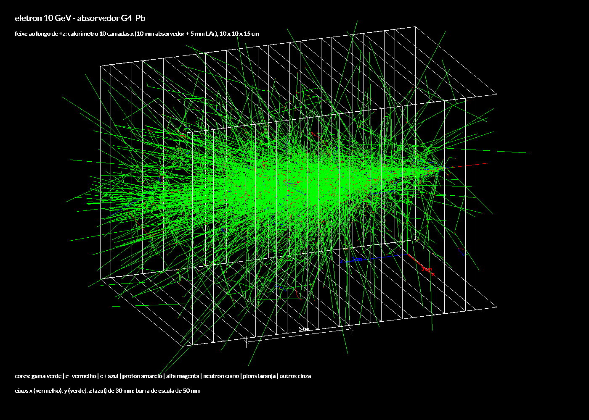
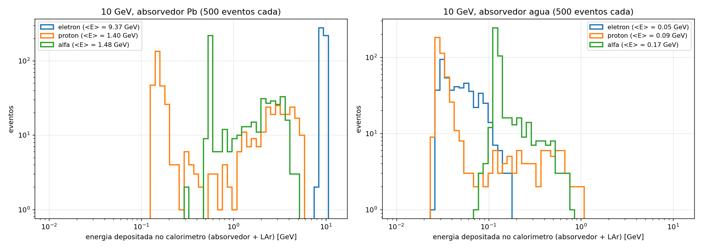
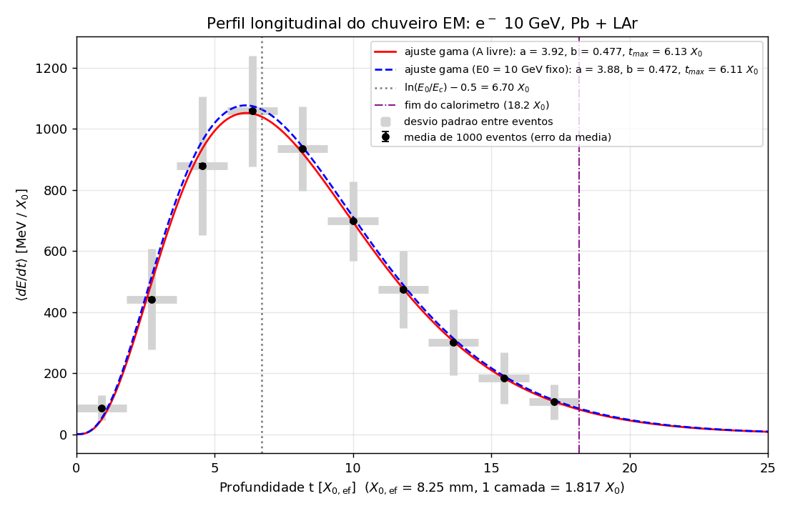
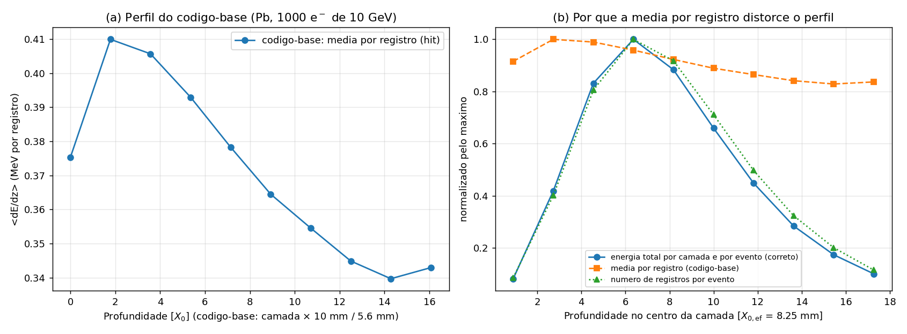
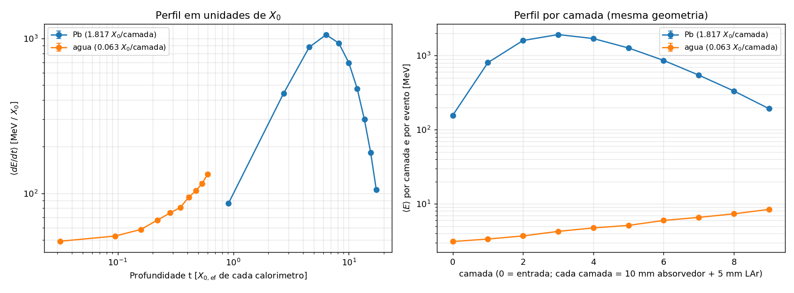

# F056 - Lista: Simulação de Detectores com Geant4 (exemplo B4a)

As respostas completas, com as figuras e a discussão, estão no **[relatório em PDF](relatorio/relatorio.pdf)**.
Este README explica como compilar e rodar tudo e resume os resultados.

## Conteúdo

| arquivo / pasta | o que é |
|---|---|
| `relatorio/relatorio.pdf` (`.tex`, `Makefile`) | relatório com as respostas dos Exercícios 1 e 2 |
| `B4a/` | exemplo `basic/B4/B4a` do Geant4 11.4.3, **com as minhas modificações** (marcadas com `[lista_geant4]` no código) |
| `modificacoes_B4a.diff` | diff entre o B4a original e o modificado |
| `macros/` | macros `.mac` (figuras do Ex. 1, estatística do Ex. 1 e simulações do Ex. 2) |
| `perfil_longitudinal.py` | programa do Exercício 2 (perfil longitudinal, ajuste, contenção, Pb x água) |
| `estatistica_ex1.py` | tabela e histograma de energia depositada de e-, p e alfa (Exercício 1) |
| `roda_tudo.sh` | compila e roda tudo em sequência |
| `figuras/` | todas as figuras |
| `resultados_ex1.txt`, `resultados_ex2.txt` | saídas dos programas de análise |

Não versionei `build/`, `saidas/` (os CSV do Exercício 2 dão ~1 GB), `*.csv` nem `*.root` (ver `.gitignore`).

## Ambiente

Usei o Geant4 11.4.3 do conda-forge, num ambiente separado:

```
mamba create -n g4env -c conda-forge geant4 cmake make cxx-compiler expat zlib xerces-c libgl-devel libglu \
      python=3.12 numpy pandas scipy matplotlib
conda activate g4env
```

(`expat`, `zlib`, `xerces-c` e `libgl-devel` são necessários para o `find_package(Geant4)` do CMake achar as versões
do próprio ambiente; sem eles ele pegava as do sistema, que são antigas.)
O pacote do conda já traz os dados de física (`geant4-config --check-datasets`), mas **não traz os exemplos**.
O B4a foi copiado do repositório oficial, tag `v11.4.3`, diretório `examples/basic/B4/B4a`.

## Compilar e rodar

```
conda activate g4env
cd lista_geant4
bash roda_tudo.sh            # compila e roda tudo (~2 min com 8 threads)
```

ou por partes: `bash roda_tudo.sh figuras | estat | perfil | analise`.

Na mão:

```
mkdir build && cd build
cmake ../B4a -DCMAKE_PREFIX_PATH=$CONDA_PREFIX
make -j4
cp ../macros/*.mac .
./exampleB4a -m eletron_10GeV_Pb.mac        # gera eletron_10GeV_Pb.png
./exampleB4a -m perfil_Pb.mac               # 1000 e- de 10 GeV -> calo_output_nt_CaloHits_t*.csv
python3 ../perfil_longitudinal.py --pb 'calo_output_nt_CaloHits_t*.csv' --pb-eventos 'calo_output_nt_B4_t*.csv' --saida ../figuras
```

O relatório: `cd relatorio && make`.

Observação: as macros chamam umas às outras pelo nome (`/control/execute figura.mac`), então devem estar no diretório
onde o programa roda. O `roda_tudo.sh` copia as macros para cada diretório em `saidas/`. Fiz assim porque o caminho do
meu repositório tem espaço e o `/control/execute` não aceita.

## Modificações no B4a

- **`DetectorConstruction`**: comando `/B4/det/absorberMaterial <material NIST>` (com `G4GenericMessenger`), para trocar o
  absorvedor sem recompilar (usar antes de `/run/initialize`). Por padrão continua `G4_Pb`. Também imprime X0 e
  lambda_I dos materiais.
- **`RunAction`**: saída em CSV com nome `calo_output` e a ntuple `CaloHits` (id 1), com as colunas
  `Edep_MeV, Layer, x, y, z` do enunciado e mais `EventID` e `IsGap` (0 = absorvedor, 1 = LAr).
  `SetActivation(true)` permite desligar essa ntuple na macro com `/analysis/ntuple/setActivation 1 false`.
- **`SteppingAction`**: um registro por passo com deposição de energia dentro do absorvedor ou do gap
  (camada = `GetReplicaNumber(1)`, de 0 a 9).

## Macros

| macro | para quê |
|---|---|
| `figura.mac` | visualização genérica (usa aliases `{material}`, `{particula}`, `{arquivo}`, `{titulo}`, `{nvis}`) |
| `eletron_10GeV_Pb.mac`, `proton_...`, `alfa_...` | Ex. 1(b): 1 evento de 10 GeV com chumbo |
| `*_10GeV_agua.mac` | Ex. 1(c): o mesmo com água |
| `*_20eventos.mac` | figuras extras com 20 eventos sobrepostos (p e alfa) |
| `estatistica.mac` | 500 eventos sem visualização, só a ntuple B4 (tabela do Ex. 1) |
| `perfil.mac`, `perfil_Pb.mac`, `perfil_agua.mac` | Ex. 2: 1000 e- de 10 GeV com cada absorvedor |

A visualização usa o driver `TSG_OFFSCREEN`, que grava o PNG direto sem abrir janela. O Geant4 do conda também tem
OpenGL/Qt (`geant4-config --has-feature opengl-x11` = yes), então a versão com `/vis/open OGL` + `/vis/ogl/export` do
enunciado (comentada no `figura.mac`) deve funcionar, mas não usei para não ter que abrir janelas.

## Resumo dos resultados

### Exercício 1

Calorímetro de amostragem Pb/LAr: 10 camadas de (10 mm Pb + 5 mm LAr), 10 x 10 cm², 15 cm de comprimento
= **18,2 X0** e **0,61 lambda_I**. Com água: **0,63 X0** e **0,19 lambda_I**.

| absorvedor | partícula | energia depositada / E0 | sem chuveiro (só MIP) |
|---|---|---|---|
| Pb | e- | 0,937 ± 0,021 | - |
| Pb | próton | 0,140 ± 0,162 | 51 % |
| Pb | alfa | 0,148 ± 0,112 | 50 % |
| água | e- | 0,0054 | - |
| água | próton | 0,0089 | 77 % |
| água | alfa | 0,0166 | 80 % |

(± = rms entre eventos; 500 eventos por caso)




### Exercício 2 (1000 e- de 10 GeV)

- **(b)** a média por registro do código-base fica quase plana (0,34–0,41 MeV por passo) e não mostra o chuveiro.
  O correto é somar por camada dentro de cada evento (por isso o `EventID`) e só depois fazer a média e o desvio entre eventos.
- **(c)** cada camada tem 15 mm (não 10). O X0 efetivo é 15 / (10/5,61 + 5/140,6) = **8,25 mm**, ou seja,
  1,817 X0 por camada. No chumbo o código-base erra só −1,7 % (coincidência); com água o erro é de −56 %.
- **(d)** ajuste gama (integrado em cada camada): a = 3,92, b = 0,477, **t_max = 6,13 ± 0,01 X0**, contra
  ln(E0/Ec) − 0,5 = 6,70 X0.
- **(e)** contenção de **93,8 %** (Pb 88,9 % + LAr 4,9 %; fração de amostragem 5,2 %); 2,5 % escapa pela parte de
  trás (pelo ajuste) e o resto pelas laterais e pela frente. Com 12 camadas o vazamento longitudinal cairia para 0,7 %.
- **(f)** com água, X0_ef = 237 mm e o calorímetro tem só 0,63 X0: só aparece o começo do chuveiro e fica 0,5 % da energia.




